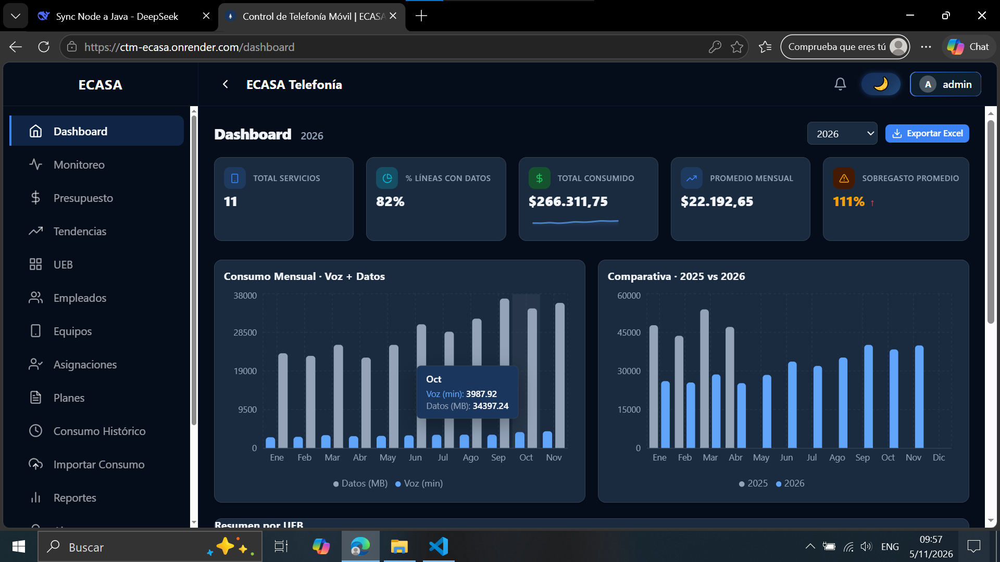
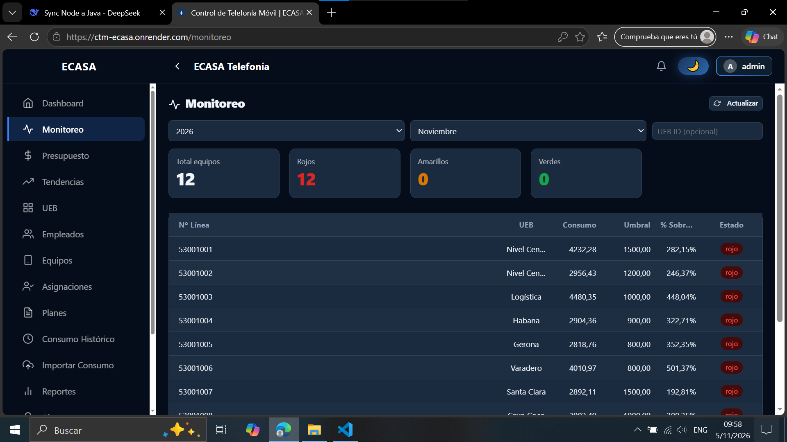
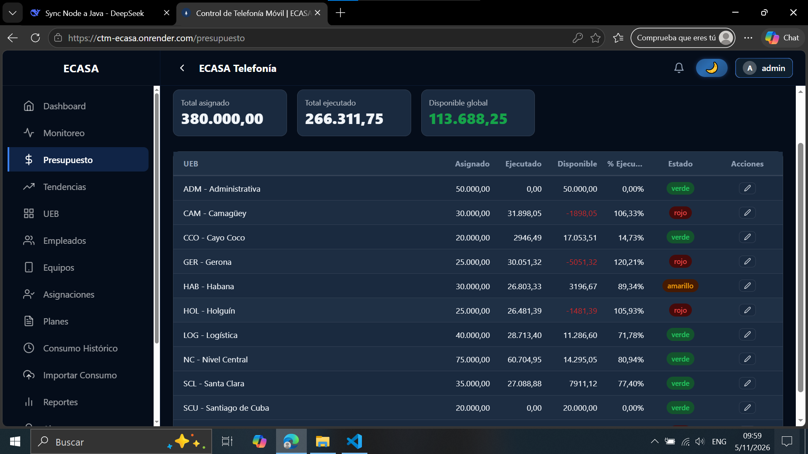
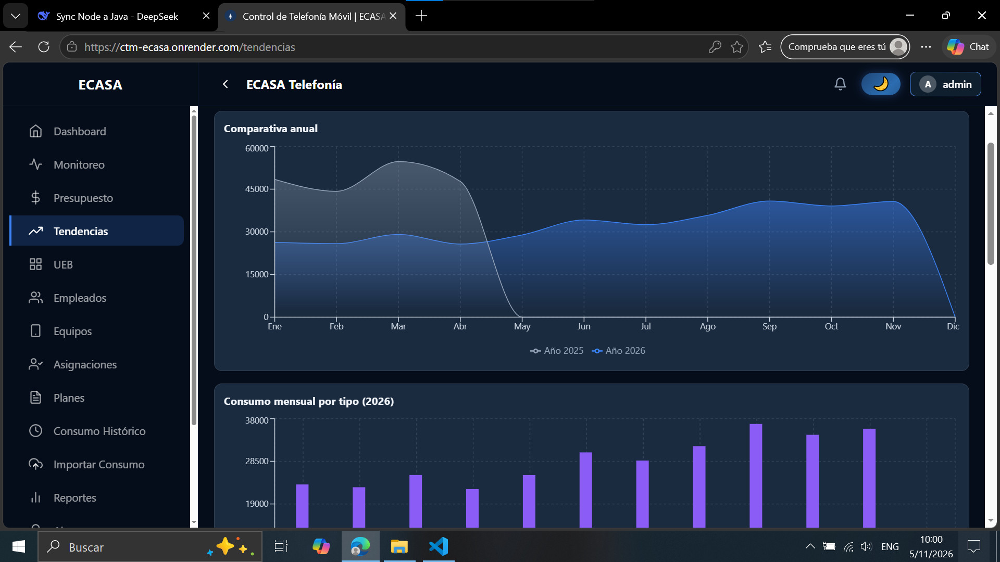
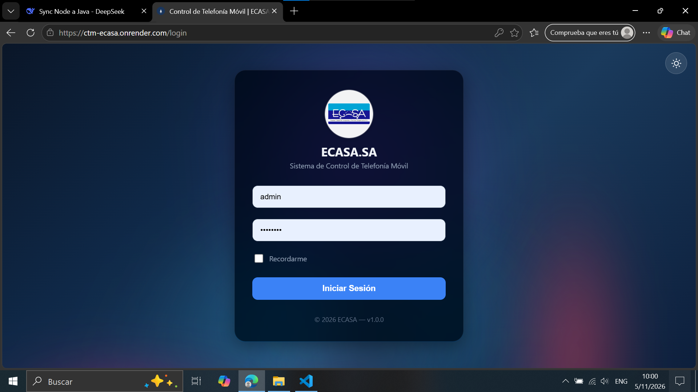
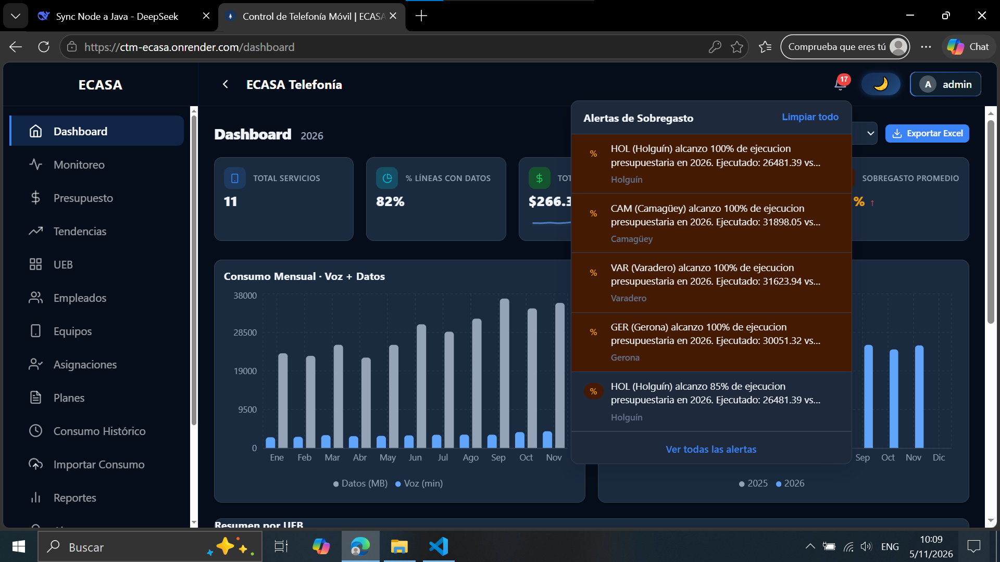

# 🏢 CTM | ECASA S.A.

### Sistema de Control de Telefonía Móvil

**Sistema empresarial de gestión de telefonía móvil** para ECASA S.A. — control de equipos, empleados, planes tarifarios, consumo mensual, presupuesto anual por UEB, alertas automáticas de sobregasto y auditoría completa de operaciones.

[🚀 Demo en vivo](https://ctm-ecasa.onrender.com) · [📚 API Docs](https://telefonia-ecasa.onrender.com/swagger-ui.html) · [🐛 Reportar bug](https://github.com/erinnodarse23/telefonia-ecasa/issues)

---

## 🔑 Credenciales de demo

| Rol | Login | Password |
|-----|-------|----------|
| **Administrador** | `admin` | `admin123` |

> ⚠️ El backend en Render free tier puede tardar 30-60 segundos en despertar (cold start). Ten paciencia en el primer login.

---

## 📸 Screenshots

| Dashboard | Monitoreo |
|-----------|-----------|
|  |  |

| Presupuesto | Tendencias |
|-------------|-----------|
|  |  |

| Login | Alertas |
|-------|---------|
|  |  |

---

## 🎯 Features destacadas

### Seguridad
- 🔐 **Autenticación JWT** con expiración configurable (1h / 7d con `rememberMe`)
- 🛡️ **Captcha** después de 3 intentos fallidos de login
- 🚦 **Rate limiting en 4 niveles** (login, carga, exportación, global) por IP
- 🔒 **Sanitización XSS** con OWASP Java HTML Sanitizer
- 📋 **Auditoría completa** de operaciones con IP, usuario, timestamp y descripción
- 👥 **RBAC** (Role-Based Access Control) con 3 roles y scoping por UEB

### Gestión de negocio
- 📱 **Equipos** con estado físico, marca, modelo y observaciones
- 👤 **Empleados** con cargo, teléfono y UEB de pertenencia
- 📋 **Asignaciones** equipo↔empleado con histórico y auto-cierre
- 📄 **Planes tarifarios** con voz/datos/SMS/cuota y auto-cierre al crear uno nuevo
- 📊 **Consumo mensual** con carga masiva desde Excel (upsert idempotente)

### Analytics
- 📈 **Dashboard** con gráficos interactivos (Recharts): totales mensuales, comparativa anual, resumen por UEB
- 📉 **Indicadores** consolidados por UEB con promedios, estimación de cierre y % de sobregasto
- 🎯 **Monitoreo** en tiempo real con semáforos (verde/amarillo/rojo) por equipo, auto-refresh cada 30s
- 💰 **Presupuesto anual** por UEB con edición inline (solo Administrador)
- 📊 **Tendencias** con rankings top/bottom 10 y comparativa año actual vs anterior

### Alertas inteligentes (2 capas)
- 🚨 **Semáforo visual** en Monitoreo: cálculo en tiempo real de `consumo_actual / cuota_mensual`
- 🔔 **Alertas persistentes** en BD por UEB: `PRESUPUESTO_70`, `PRESUPUESTO_85`, `PRESUPUESTO_100` y `SOBREGASTO`
- 📬 **Campana de notificaciones** con auto-refresh cada 30s
- ✅ Marcado individual / masivo como leídas
- 🗄️ Archivo de alertas descartadas

### Exportación
- 📄 **PDF** con OpenPDF: responsables, equipos, dashboard, trazas de auditoría
- 📊 **Excel** con Apache POI: responsables, equipos, dashboard, trazas (con fix de `workbook.write`)

## 🛠️ Stack técnico

### Backend
| Tecnología | Versión | Uso |
|-----------|---------|-----|
| **Java** | 17 | Lenguaje |
| **Spring Boot** | 3.4.5 | Framework principal |
| **Spring Security** | (incluido) | Autenticación JWT + RBAC |
| **Spring JDBC** | (incluido) | Acceso a datos con `JdbcTemplate` |
| **Spring Validation** | (incluido) | Bean Validation (`@NotNull`, `@Min`, etc.) |
| **Springdoc OpenAPI** | 2.8.6 | Swagger UI + OpenAPI 3 |
| **PostgreSQL Driver** | (incluido) | Conexión a PostgreSQL |
| **JJWT** | 0.12.6 | Generación y validación de JWT |
| **Caffeine** | (incluido) | Caché en memoria para queries del dashboard |
| **Apache POI** | 5.4.1 | Generación de Excel (.xlsx) |
| **OpenPDF** | 2.0.3 | Generación de PDF |
| **OWASP Sanitizer** | 20240325.1 | Sanitización XSS |

### Frontend
| Tecnología | Versión | Uso |
|-----------|---------|-----|
| **React** | 19.2.6 | Framework UI |
| **Vite** | 8.0.12 | Build tool + dev server |
| **React Router** | 7.15.1 | Routing con lazy loading |
| **Recharts** | 3.8.1 | Gráficos interactivos |
| **Axios** | 1.16.1 | Cliente HTTP con interceptores |
| **Sonner** | 2.0.7 | Toasts de notificaciones |
| **React Icons** | 5.6.0 | Iconos (Feather Icons) |
| **Vitest** | 5.1.0 | Tests unitarios |
| **Testing Library** | 16.3.3 | Utilidades de test |

### Infraestructura
| Servicio | Uso |
|----------|-----|
| **Render** | Hosting backend + frontend (free tier) |
| **ZevCloud** | PostgreSQL 16 gestionado |
| **GitHub** | Repositorio + CI |

---

## 🏗️ Arquitectura

~~~mermaid
graph TB
    subgraph "Cliente"
        A[React 19 + Vite]
    end
    subgraph "Render backend"
        B[Spring Boot 3.4.5]
        B1[JWT Filter]
        B2[Rate Limit Filter]
        B3[Security Headers]
        B4[Access Log]
        B --> B1
        B --> B2
        B --> B3
        B --> B4
        B --> C[Controllers]
        C --> D[Services]
        D --> E[Repositories JdbcTemplate]
    end
    subgraph "Render frontend"
        F[Static Site Nginx]
    end
    subgraph "ZevCloud"
        G[(PostgreSQL 16)]
    end
    A -->|HTTPS JWT| B
    A --> F
    E --> G
    B --> H[PDF/Excel Export]
    B --> I[Audit Logs]
    style A fill:#61DAFB
    style B fill:#6DB33F
    style G fill:#336791
    style F fill:#646CFF
~~~

### Estructura del proyecto

~~~
telefonia-ecasa/
├── backend/                    # Spring Boot 3.4.5
│   ├── src/main/java/cu/ecasa/api/
│   │   ├── config/            # SecurityConfig, RateLimitFilter, CORS, Cache
│   │   ├── controllers/       # 14 controllers REST
│   │   ├── dto/               # request/ + response/ (records)
│   │   ├── exceptions/        # ApiExceptionHandler + custom
│   │   ├── mapper/            # Mappers Map->DTO
│   │   ├── repository/        # 14 repositories JdbcTemplate
│   │   ├── security/          # JwtService, JwtAuthenticationFilter
│   │   ├── service/           # 20+ services con lógica de negocio
│   │   └── util/              # ExcelValueParser, etc.
│   └── src/test/java/         # 82 tests (JUnit 5 + Mockito)
├── frontend/                   # React 19 + Vite 8
│   ├── src/
│   │   ├── components/        # Layout, Sidebar, ConfirmModal, etc.
│   │   ├── contexts/          # AuthContext, ThemeContext
│   │   ├── pages/             # 17 páginas + 3 tests
│   │   ├── services/          # api.js (axios + interceptores)
│   │   ├── styles/            # global.css
│   │   ├── test/              # setup.js (Vitest)
│   │   └── utils/             # pagePrefetch (lazy loading)
│   └── vitest.config.js
├── database/                   # 18 scripts SQL idempotentes
├── docs/                       # Screenshots + documentación
├── docker-compose.yml
└── README.md

## 🧪 Tests

~~~bash
# Backend (82 tests)
cd backend && mvn test
# Tests run: 82, Failures: 0, Errors: 0, Skipped: 0
# BUILD SUCCESS

# Frontend (10 tests)
cd frontend && npm run test:run
# Test Files  3 passed (3)
#      Tests  10 passed (10)
~~~

| Suite | Tests | Cobertura |
|-------|-------|-----------|
| `MonitoreoServiceTest` | 7 | Semáforo, defaults, filtros, % de sobregasto |
| `PresupuestoServiceTest` | 6 | Estados, ejecución, `@JsonAlias` |
| `ConsumoServiceTest` | 10 | Validaciones, duplicados, alertas |
| `DashboardServiceTest` | 6 | Relleno de 12 meses, comparativas, multi-UEB |
| `ReporteServiceTest` | 4 | Ranking top/bottom, validación de estado |
| `PdfServiceTest` | 4 | Generación de PDF (%PDF header) |
| `AlertGenerationServiceTest` | 6 | Generación de alertas por umbral |
| `UsuarioServiceTest` | 6 | CRUD + roles |
| `TokenCleanupServiceTest` | 3 | Limpieza de tokens expirados |
| `TrazaServiceTest` | 3 | Auditoría |
| `TrazaRepositoryIpNormalizationTest` | 7 | Normalización de IPs |
| `ExcelValueParserTest` | 17 | Parseo de Excel |
| `EcasaApiApplicationTests` | 3 | Context load + health |
| `Monitoreo.test.jsx` | 3 | Render + fetch + tabla |
| `Presupuesto.test.jsx` | 3 | Render + fetch + tabla |
| `Tendencias.test.jsx` | 4 | Render + fetch + gráficos + rankings |
| **Total** | **92** | ✅ |

---

## 🚀 Quick Start

### Opción 1 — Docker (1 comando)

~~~bash
git clone https://github.com/erinnodarse23/telefonia-ecasa.git
cd telefonia-ecasa
docker compose up -d
~~~

- Backend: http://localhost:5001
- Frontend: http://localhost:5173
- Swagger: http://localhost:5001/swagger-ui.html

### Opción 2 — Local (manual)

**Requisitos:** Java 17, Maven, Node 22+, PostgreSQL 16

~~~bash
# 1. Clonar
git clone https://github.com/erinnodarse23/telefonia-ecasa.git
cd telefonia-ecasa

# 2. Crear BD y ejecutar schema
psql -U postgres -c "CREATE DATABASE telefonia_db;"
psql -U postgres -d telefonia_db -f database/01_full_schema.sql
psql -U postgres -d telefonia_db -f database/02_seed_data.sql

# 3. Backend
cd backend
mvn spring-boot:run

# 4. Frontend (en otra terminal)
cd frontend
npm install
npm run dev
~~~

## 📚 API Documentation

Swagger UI disponible en: **https://telefonia-ecasa.onrender.com/swagger-ui.html**

### Endpoints principales

| Método | Endpoint | Descripción |
|--------|----------|-------------|
| `POST` | `/api/auth/login` | Login con JWT + captcha opcional |
| `GET` | `/api/health` | Health check (verifica BD + uptime) |
| `GET` | `/api/dashboard/totales?anio=X` | Totales mensuales del año |
| `GET` | `/api/dashboard/indicadores?anio=X` | Indicadores consolidados por UEB |
| `GET` | `/api/monitoreo/estado?anio=X&mes=Y` | Semáforo por equipo |
| `GET` | `/api/presupuesto?anio=X` | Presupuesto anual por UEB |
| `POST` | `/api/presupuesto` | Actualizar presupuesto (Admin) |
| `GET` | `/api/reportes/tendencias?anio=X` | Tendencias + rankings |
| `POST` | `/api/consumo` | Crear consumo manual |
| `GET` | `/api/exportar/dashboard/pdf?anio=X` | PDF del dashboard |
| `GET` | `/api/exportar/trazas/pdf?limit=N` | PDF de trazas |

---

## 🤔 Decisiones técnicas destacadas

### 1. `JdbcTemplate` en vez de JPA/Hibernate
El 80% de las queries del dashboard son agregaciones complejas con `LEFT JOIN LATERAL`, `make_date()`, `SUM/AVG` anidados. JPA las convertiría en `@Query(nativeQuery=true)` de todos modos, añadiendo overhead sin beneficio. Con `JdbcTemplate` el SQL es legible, testeable y controlable.

### 2. Atribución histórica de UEB
Un consumo del mes `(anio, mes)` se atribuye a la UEB de la asignación **activa al último día del mes**, no a la actual. Si un equipo cambió de UEB el día 15, todo el consumo del mes va al nuevo destino.

Es el estándar en reportes financieros mensuales ("responsable al cierre del período"). Evita que un cambio a mitad de mes "regale" el consumo de 15 días a la UEB anterior.

Implementado con `make_date(anio, mes, 1) + interval '1 month - 1 day'` en PostgreSQL (equivalente a `last_day` de MySQL).

### 3. Dos capas de alertas

| Capa | Dónde | Persiste | Scope |
|------|-------|----------|-------|
| **Semáforo visual** | Monitoreo | ❌ (en tiempo real) | Por equipo |
| **Alertas persistentes** | BD + campana | ✅ | Por UEB |

Son problemas distintos. El semáforo te dice "este equipo está gastando mucho respecto a su cuota mensual". Las alertas te dicen "la UEB completa cruzó el 70/85/100% de su presupuesto anual". Necesitas las dos.

### 4. Rate limiting en 4 niveles

| Nivel | Path | Límite | Por qué |
|-------|------|--------|---------|
| Login | `/api/auth/login` | 10/min | Evitar fuerza bruta |
| Carga | `/api/carga` | 10/min | Evitar DoS por uploads |
| Exportación | `/api/exportar` | 20/min | Evitar DoS por generación PDF/Excel |
| Global | `/api/**` | 2000/15min | Protección general |

Implementado en memoria (`ConcurrentHashMap` + `synchronized`), sin dependencias externas. Para producción distribuida, migrar a Redis + Bucket4j.

### 5. Auditoría con `REQUIRES_NEW`
Si una traza de auditoría falla dentro de la transacción principal, PostgreSQL deja la conexión en estado `aborted` y el commit final falla con `current transaction is aborted`.

Solución: `@Transactional(propagation = Propagation.REQUIRES_NEW)` en `TrazaService.registrar()`. La traza corre en su propia conexión y, si falla, solo revierte la traza. La operación de negocio se completa.

Trade-off: si el negocio falla después de que la traza commiteó, la traza queda registrada aunque el negocio no se completara. Esto es **deseable** en auditoría: refleja el *intento*, no solo el éxito.

## 📝 Roadmap

### ✅ Completado
- [x] Backend Java 17 + Spring Boot 3.4
- [x] Autenticación JWT + captcha + rate limiting
- [x] 14 controllers REST documentados con Swagger
- [x] Módulo de Monitoreo con semáforos
- [x] Módulo de Presupuesto con edición inline
- [x] Módulo de Tendencias con rankings y comparativas
- [x] Alertas persistentes con campana
- [x] Exportación PDF/Excel (6 endpoints)
- [x] Auditoría completa de operaciones
- [x] 92 tests verdes (82 backend + 10 frontend)
- [x] Docker Compose para desarrollo local

### 🚧 Futuro
- [ ] Migrar rate limiting a Redis para multi-instancia
- [ ] WebSockets para alertas en tiempo real (sin polling)
- [ ] Tests E2E con Playwright
- [ ] CI/CD con GitHub Actions (lint + test + deploy)
- [ ] Internacionalización (español / inglés)
- [ ] Dark mode persistente por usuario

---

## 🤝 Contribución

1. Fork el repo
2. Crea una rama (`git checkout -b feature/nueva-funcionalidad`)
3. Commit cambios (`git commit -m "feat: nueva funcionalidad"`)
4. Push (`git push origin feature/nueva-funcionalidad`)
5. Abre un Pull Request

**Convención de commits:** [Conventional Commits](https://www.conventionalcommits.org/) — `feat:`, `fix:`, `test:`, `docs:`, `refactor:`

---

## 📄 License

MIT — ver [LICENSE](LICENSE) para detalles.

---

## 👤 Autor

**Erin Nodarse** ([@erinnodarse23](https://github.com/erinnodarse23))

- 🐙 GitHub: [erinnodarse23](https://github.com/erinnodarse23)
- 💼 Portafolio: [erinnodarse.vercel.app](https://erinnodarse.vercel.app)

---

**⭐ Si este proyecto te resultó útil, dale una estrella en GitHub** ⭐

Hecho con ❤️ en Cuba 🇨🇺

